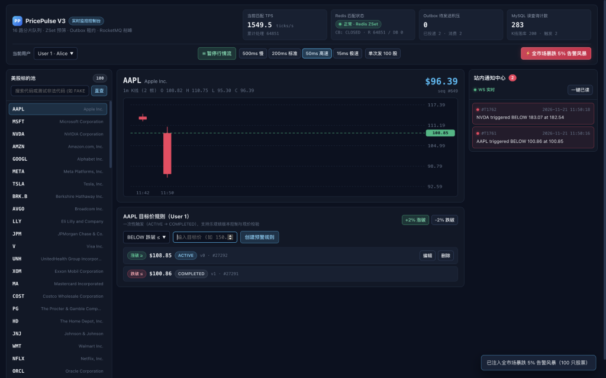

# PricePulse V3

面向多用户的实时行情监控与一次性目标价预警平台，基于 **Java 21、Spring Boot 3.5、MyBatis、Flyway、MySQL 8.4、Redis 7、RocketMQ 5.3、Resilience4j** 与 **Vue 3 + TypeScript** 构建，聚焦高并发匹配吞吐、缓存一致性、熔断降级与异步可靠通知。

## 控制台实时预览



## 核心架构设计

- **多路单线程有界分片队列（`market`）**：行情按股票代码高位异或扰动哈希路由到固定分片线程池（`pricepulse.lanes=16`，`quote-lane-0` 到 `15`，`ArrayBlockingQueue(1024)`），保证同股严格有序、多股并发；压测可控模式下采用阻塞背压等待队尾空位，并在各分片内基于 `(lastEventTs, lastSeq)` 无锁拦截乱序迟到旧包。
- **Redis ZSet 预筛与 MySQL 乐观锁触发（`rule`）**：按股票将规则拆分为 `rules:above:{stockId}` 和 `rules:below:{stockId}` 两个 ZSet（score 存美分整数，避免浮点误差），通过 Lua 预筛过滤不触发行情；命中后基于 `WHERE status='ACTIVE' AND version=#{version}` 与价格条件的 MySQL 乐观锁及 `rule_id` 唯一索引完成一次性触发，避免悲观锁争用。
- **规则索引同步与熔断降级**：规则变更在事务提交后（`AFTER_COMMIT`）由单线程 `rule-index-maintainer` 回查 MySQL 最新状态异步刷新 Redis（消除并发乱序覆盖），并每 30 秒串行全量对账兜底；接入 Resilience4j 熔断器，并在 Lua 开头检查哨兵 Key `pricepulse:v3:index:ready` 防空库重启误判，异常时自动降级走 `UNION ALL` 覆盖索引（`idx_match`），待全量重建并消化队列后经恢复门禁切回。
- **Outbox 本地事务表与 RocketMQ 削峰（`alert`）**：触发记录与 `outbox_events` 同事务落库；发布端通过 `FOR UPDATE SKIP LOCKED` 并发领用并写入唯一 `leaseId`（`locked_by` 防超时覆盖），采用 `1s` 到 `30s` 有上限指数退避持续重试；消费端收窄并发（`4` 到 `8` 线程）削峰，落库靠 `trigger_id` 唯一索引幂等后执行手动 ACK，并通过 WebSocket 实时推送前端。
- **高频读缓存与按分钟聚合写优化**：实时最新价写内存与 Redis Hash（`quote:latest:{symbol}`），历史走势按 1 分钟在内存聚合 OHLC 后批量 `UPSERT` 到 `kline_1m`（替代逐笔写库）；读接口采用 Cache-Aside，结合空值缓存防穿透、`SET NX EX 5` 互斥锁防热门股击穿、随机 TTL 偏移防雪崩。

---

## 快速启动

### 1. 启动基础中间件（MySQL 8.4 / Redis 7 / RocketMQ 5.3）
```bash
docker compose -f compose.yaml up -d
docker compose -f compose.yaml ps
```

### 2. 启动后端与前端
```bash
# 后端（http://127.0.0.1:8080）
JAVA_HOME=/opt/homebrew/opt/openjdk PATH="/opt/homebrew/opt/openjdk/bin:$PATH" mvn spring-boot:run

# 前端（http://127.0.0.1:5173）
cd frontend && npm install && npm run dev
```

### 3. 运行测试、压测与故障演练
```bash
# 单元与集成测试（20 项）
JAVA_HOME=/opt/homebrew/opt/openjdk PATH="/opt/homebrew/opt/openjdk/bin:$PATH" mvn test

# Phase 6 同口径 A/B 压测与 5,000 条规则 EXPLAIN ANALYZE
JAVA_HOME=/opt/homebrew/opt/openjdk PATH="/opt/homebrew/opt/openjdk/bin:$PATH" mvn -Dtest=Phase6Benchmark test

# Phase 6 高可用故障演练（需先启动 :8080 后端与 Docker Compose）
python3 scripts/phase6_fault_drills.py
```

---

## 同口径 A/B 压测结果

通过 [Phase6Benchmark.java](src/test/java/com/pricepulse/benchmark/Phase6Benchmark.java) 在本机 Docker MySQL 8.4.7、Redis 7.4.6、RocketMQ 5.3.2 环境下实测：

1. **高并发规则匹配 A/B**：100 只股票 x 50 条规则（共 **5,000** 条规则），确定性回放 **20,000** 条行情（200 轮 x 100 股，128 并发派发，每轮精确触发 **500** 条）。
2. **多用户并发读 A/B**：**100** 并发线程 x 200 请求（共 **20,000** 次 HTTP 请求：45% 热门股实时价、45% 热门股 60 条分钟走势、10% 随机不存在代码 `INVALID_00..49`，冷缓存起点）。

| 测试场景 | 基线（关闭优化 / 直查 MySQL） | 优化（开启 Redis 预筛 / 读缓存） | 对比提升 |
| --- | --- | --- | --- |
| **规则匹配**（`force-db-fallback`: `true` vs `false`，5,000 规则 / 20,000 行情） | **5,973.28 TPS** · P50 `2.521 ms` · P95 `154.247 ms` · P99 `183.164 ms`（耗时 `3.348 s`，触发 `500` 条） | **7,701.58 TPS** · P50 `1.954 ms` · P95 `123.062 ms` · P99 `150.125 ms`（耗时 `2.597 s`，触发 `500` 条） | **1.29x TPS** · P95 **-20.2%** · 触发结果 `500 == 500`（卸掉匹配阶段 2 万次 MySQL 查询） |
| **并发读**（`read-cache.enabled`: `false` vs `true`，100 线程 / 20,000 请求） | **4,749.88 QPS** · P50 `17.534 ms` · P95 `46.950 ms` · P99 `68.742 ms`（耗时 `4.211 s`）· 应用查库 `29,009` 次（MySQL `Com_select` `29,043`） | **9,181.67 QPS** · P50 `10.179 ms` · P95 `16.632 ms` · P99 `22.389 ms`（耗时 `2.178 s`）· 应用查库 `113` 次（MySQL `Com_select` `123`） | **1.93x QPS** · P95 **-64.6%** · 应用查库 **-99.61%**（`Com_select` **-99.58%**） |

### 5,000 条规则降级 SQL `EXPLAIN ANALYZE` 实测输出

```text
-> Append  (cost=0.92 rows=2) (actual time=0.0135..0.0135 rows=0 loops=1)
    -> Stream results  (cost=0.46 rows=1) (actual time=0.00729..0.00729 rows=0 loops=1)
        -> Filter: ((alert_rules.direction = 'ABOVE') and (alert_rules.`status` = 'ACTIVE') and (alert_rules.stock_id = 1) and (alert_rules.threshold_price <= 100.00))  (cost=0.46 rows=1) (actual time=0.00658..0.00658 rows=0 loops=1)
            -> Covering index range scan on alert_rules using idx_match over (stock_id = 1 AND status = 'ACTIVE' AND direction = 'ABOVE' AND threshold_price <= 100.00)  (cost=0.46 rows=1) (actual time=0.00621..0.00621 rows=0 loops=1)
    -> Stream results  (cost=0.46 rows=1) (actual time=0.00192..0.00192 rows=0 loops=1)
        -> Filter: ((alert_rules.direction = 'BELOW') and (alert_rules.`status` = 'ACTIVE') and (alert_rules.stock_id = 1) and (alert_rules.threshold_price >= 100.00))  (cost=0.46 rows=1) (actual time=0.00188..0.00188 rows=0 loops=1)
            -> Covering index range scan on alert_rules using idx_match over (stock_id = 1 AND status = 'ACTIVE' AND direction = 'BELOW' AND 100.00 <= threshold_price)  (cost=0.46 rows=1) (actual time=0.00179..0.00179 rows=0 loops=1)
```

`UNION ALL` 两段均直接命中 **`idx_match` 覆盖索引范围扫描**，零全表扫描。

---

## 高可用故障演练结果

通过 [phase6_fault_drills.py](scripts/phase6_fault_drills.py) 对打包后的 `price-pulse-v3-0.0.1-SNAPSHOT.jar` 实测：

| 演练项目 | 注入故障与验证步骤 | 实测结果与指标 |
| --- | --- | --- |
| **1. Redis 宕机与空库重启** | `docker compose stop redis` -> 触发规则 1（`AAPL`）并新建规则 2（`MSFT`）-> `docker compose start redis`（无持久化空库重启） | 熔断器 **0.05 s** 打开切 `DB_FALLBACK`（`redisIndexReady=false`），规则 1 正常触发投递（`1/1/1`）；空库重启后恢复门禁从 MySQL 重建 ZSet、写入哨兵 `pricepulse:v3:index:ready=1`，**0.63 s** 切回 `REDIS`，规则 2 走 Redis 正常触发（`redisMatchCount` `100 -> 200`，总计 `2/2/2`）。 |
| **2. RocketMQ 宕机与重启追平** | `docker compose stop rocketmq-broker` -> 暴跌风暴触发 **20** 条规则 -> 持续停机超过 8 次重试（`1s` 到 `30s` 指数退避）-> `docker compose start rocketmq-broker` | 停机 **125.1 s** 期间 **20** 条事件稳稳留在 `outbox_events(PENDING)`（通知表 `0` 条），最高重试达 **`max_attempts=9`**；Broker 重启后 **30.03 s** 自动追平全部积压，通知落库 **20/20**（**0** 丢失、**0** 重复）。 |
| **3. 500 条暴跌风暴与连接池** | 100 股 x 5 条 `BELOW` 规则（共 **500** 条）-> 调用 `POST /api/simulator/crash-storm?dropRatio=0.05` | 请求 **492.8 ms** 返回，全链路 **2.35 s** 消费完毕；四表严格一致：`alert_rules(COMPLETED)=500`（`ACTIVE=0`）、`alert_triggers=500`、`outbox_events(SENT)=500`（`PENDING=0`）、`notifications=500`；HikariCP（`max=20`）**0** 超时、**0** 报错。 |

---

## 测试环境与核心参数

- **主机**：Apple M4（10 核，16 GB 内存），macOS 27.2.1（`26B131`）
- **运行环境**：OpenJDK 25.0.2（编译目标 Java 21）、Spring Boot 3.5.16、Resilience4j 2.3.0
- **容器组件（`compose.yaml`）**：MySQL `8.4.7`、Redis `7.4.6-alpine`（`--save "" --appendonly no`）、Apache RocketMQ `5.3.2`（`namesrv` + `broker`）
- **核心配置**：`pricepulse.lanes=16`、`lane-queue-capacity=1024`、`hikari.maximum-pool-size=20`、`outbox.poll-interval-ms=200`（`batch-size=50`、`initial-backoff=1s`、`max-backoff=30s`）、RocketMQ 消费线程 `[4, 8]`
